  

## About

Full stack engineer based in India with 2.5 years of experience shipping web products end to end. I work mostly with React, Next.js, Node.js, TypeScript and PostgreSQL, and I care about clean APIs, fast interfaces and code that is easy to maintain. Previously worked at RedCircle, AdsFlicker and AshnaAI.

Currently building PaperX. Open to full-time Full Stack, Frontend and Backend roles.

## Projects

<table>
  <tr>
    <td></td>
    <td></td>
  </tr>
  <tr>
    <td colspan="2" align="center"></td>
  </tr>
</table>

## Stack

## GitHub activity

## Contribution snake

  

## Contact

Looking for a full-time Full Stack role. Also open to freelance work: websites, APIs and dashboards.

Email: shubh.varshneycode@gmail.com

  

## About

Full stack engineer based in India with 2.5 years of experience shipping web products end to end. I work mostly with React, Next.js, Node.js, TypeScript and PostgreSQL, and I care about clean APIs, fast interfaces and code that is easy to maintain. Previously worked at RedCircle, AdsFlicker and AshnaAI.

Currently building PaperX. Open to full-time Full Stack, Frontend and Backend roles.

## Projects

<table>
  <tr>
    <td></td>
    <td></td>
  </tr>
  <tr>
    <td colspan="2" align="center"></td>
  </tr>
</table>

## Stack

## GitHub activity

## Contribution snake

  

## Contact

Looking for a full-time Full Stack role. Also open to freelance work: websites, APIs and dashboards.

Email: shubh.varshneycode@gmail.com

  

## About

Full stack engineer from Greater Noida, India. 2.5 years of building and shipping web products with React, Next.js, Node.js, TypeScript and PostgreSQL. I have worked at RedCircle, AdsFlicker and AshnaAI, and I run my own products alongside.

Currently building PaperX. Learning Rust and system design. Open to full-time Full Stack, Frontend and Backend roles.

## Projects

<table>
  <tr>
    <td></td>
    <td></td>
  </tr>
  <tr>
    <td></td>
    <td></td>
  </tr>
</table>

## Stack

## GitHub activity

## Contribution snake

  

## Contact

Looking for a full-time Full Stack role. Also open to freelance work: websites, APIs and dashboards.

Email: shubh.varshneycode@gmail.com
